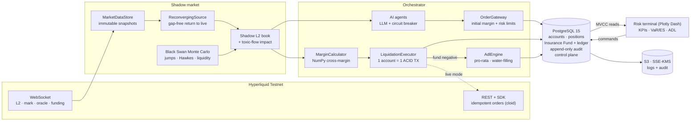
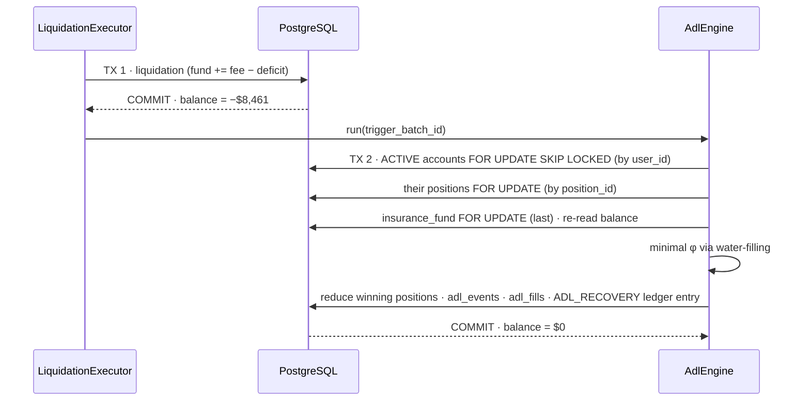
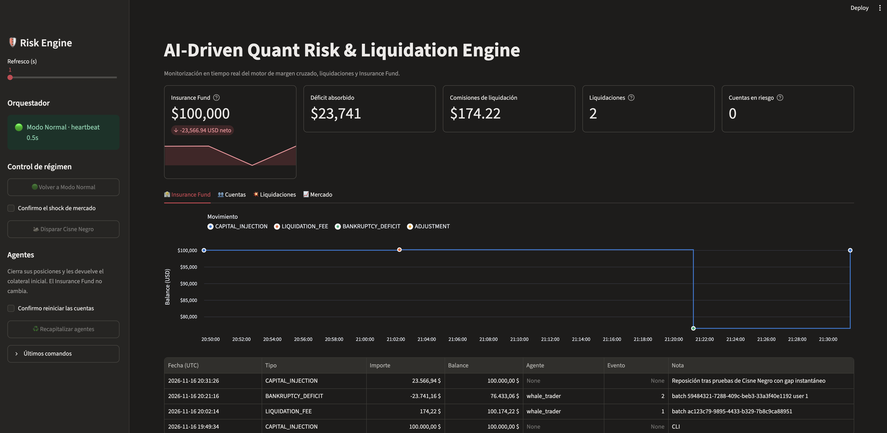
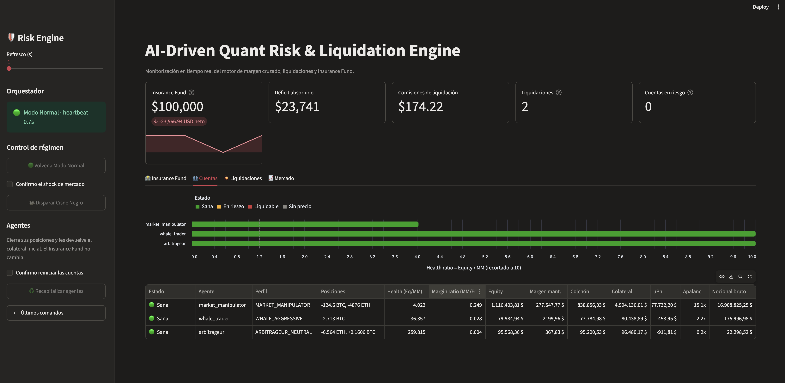
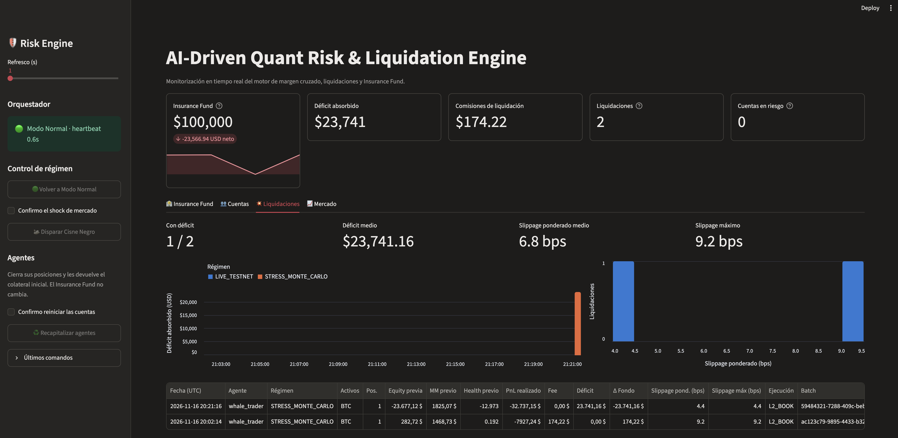
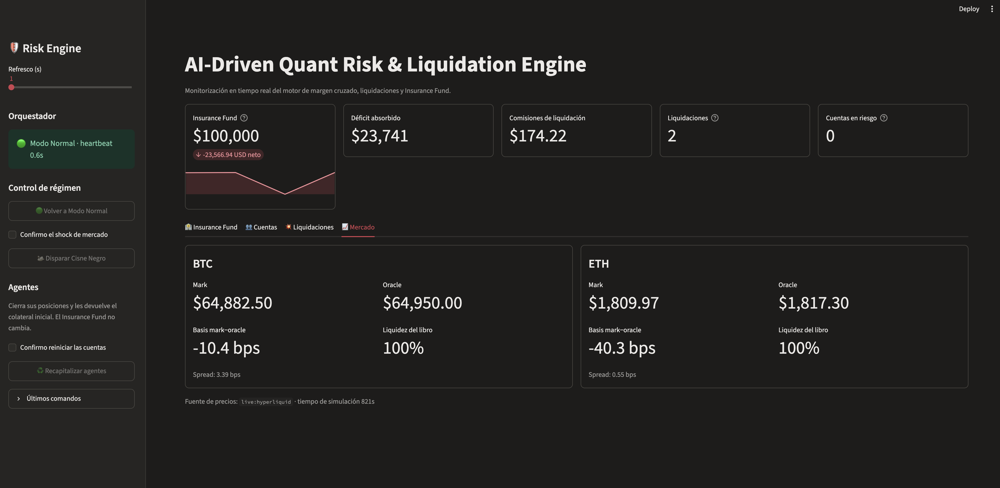
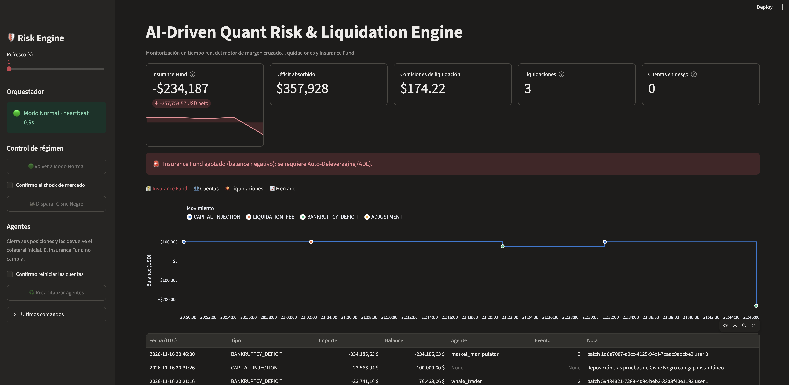

# AI-Driven Quant Risk & Liquidation Engine

**A risk engine for crypto perpetual futures (Hyperliquid): vectorized cross-margin, atomic liquidations on PostgreSQL, an Insurance Fund, Auto-Deleveraging, and a shadow market that AI agents stress-test with Black Swan scenarios.**


<sub>Full recording: [`RESULTADOS/demo_dashboard.mp4`](RESULTADOS/demo_dashboard.mp4) · [`.webm`](RESULTADOS/demo_dashboard.webm). Captured with the first (Streamlit) version of the dashboard; the UI and code comments are in Spanish.</sub>

---

## At a glance

| | |
|---|---|
| **Problem** | A perpetuals exchange must decide within milliseconds which accounts to liquidate, close them without ever leaving the system in a half-applied state, and absorb the bad debt when price gaps through the bankruptcy price. When the Insurance Fund is not enough, someone has to pay. |
| **What it does** | Computes cross-margin for every account in a single NumPy pass, liquidates each account in **one ACID transaction**, collects fees or absorbs deficits in an **Insurance Fund backed by an immutable ledger** and, if the fund goes negative, runs a **pro-rata ADL** against winning positions. |
| **How it is tested** | Three agents (LLM with structured output, or a deterministic policy) trade against a **shadow market** that mirrors Hyperliquid's L2 book. A Monte Carlo **Black Swan** (jump diffusion + Hawkes intensity + liquidity collapse) triggers the cascade. |
| **What you see** | A real-time risk terminal built with Plotly Dash: Insurance Fund, fund/Open Interest coverage, 99% VaR/ES, per-account health ratio, liquidations with slippage and the ADL history. |
| **Engineering quality** | 138 tests (unit + integration against a real PostgreSQL + the Dash app), checksummed migrations, append-only audit trail exported to S3, EC2 deployment with no inbound ports. |

---

## Architecture



| Module | Responsibility |
|---|---|
| [`exchange_connector/`](exchange_connector) | WebSocket with reconnection, heartbeat and watchdog; REST client with conservative tick/lot rounding, retries with backoff + jitter and **reconciliation by `cloid`** before retrying (a timeout can never duplicate an order). |
| [`quant_models/`](quant_models) | GARCH/GJR/EGARCH (BIC selection); historical, filtered, parametric Normal/t and Cornish-Fisher VaR/ES; **Kupiec backtest**; multi-asset Monte Carlo with systemic jumps, Hawkes intensity and a liquidity factor. |
| [`risk_engine/`](risk_engine) | Cross-margin, atomic liquidation, **risk limits**, **Auto-Deleveraging**. |
| [`ai_agents/`](ai_agents) | Agents (LangChain + Pydantic), guardrails, shadow market, order gateway, orchestrator and control plane. |
| [`database/`](database) | Schema, locking protocol, idempotent migrations with checksums and an advisory lock. |
| [`dashboard/`](dashboard) | Real-time control center (read-only MVCC queries + a command queue). |
| [`deployment/`](deployment) | Multi-target image, production compose, EC2 + SSM + S3, audit export. |

---

## Cross-margin engine

Under cross margin, an account's entire collateral backs all of its positions. For each account `u` with positions `i` (signed quantity `q`, entry price `e`, mark `m`, maintenance margin rate `mmr`):

```
uPnL_i     = q_i · (m_i − e_i)
Equity_u   = collateral_u + Σ uPnL_i
MM_u       = Σ |q_i| · m_i · mmr_i                    maintenance margin
health_u   = Equity_u / MM_u                          liquidatable  ⇔  health ≤ 1
P_liq,i    = (MM_rest − Eq_rest + q·e) / (q − |q|·mmr)      liquidation price (rest of the account held fixed)
P_bk,i     = e − Eq_rest / q                          bankruptcy price: equity = 0
```

- **Vectorized**: per-position metrics are aggregated per account with `np.bincount`, no Python loops. **100,000 accounts / 250,000 positions in ~115 ms** on a single core.
- **Fail-safe**: an account with any unknown or stale price is not evaluated (`missing_prices`), so nothing is ever liquidated on an old mark.
- **One formula everywhere**: the engine, the order gateway, the ADL and the dashboard all call `compute_margins`.

## Atomic liquidations

An account liquidation is **one transaction**: it applies in full or not at all.

```
BEGIN  (READ COMMITTED · lock_timeout · statement_timeout)
  1. SELECT … FROM users_collateral  FOR UPDATE NOWAIT     ← held by another worker: SKIPPED_LOCKED
  2. SELECT … FROM open_positions    FOR UPDATE ORDER BY position_id
  3. Re-evaluate under lock with fresh prices               ← the lock-free screening may be stale
  4. Execution: shadow L2 (+ backstop if the book cannot absorb it) or Hyperliquid reduce-only
  5. open_positions → LIQUIDATED
  6. INSERT liquidation_events                               ← append-only, idempotent batch UUID
  7. SELECT … FROM insurance_fund    FOR UPDATE               ← LAST lock: the hot row is held for ms
  8. fund += fee − deficit  ·  INSERT insurance_fund_ledger
  9. users_collateral → residual collateral, LIQUIDATED
COMMIT
```

- **Canonical lock order** `users_collateral → open_positions → insurance_fund` across the whole system (gateway, liquidator, ADL, reset): no deadlocks; residual transient failures are retried with `retry_on_transient`.
- **Exact `Decimal` accounting**: the fee never creates a deficit (`fee ≤ equity_after⁺`), fee and deficit are allocated across positions with an exact sum, and the accounting identities are enforced by `CHECK` constraints (`fund_delta = fee − deficit`).
- **Immutable audit trail**: `liquidation_events`, `insurance_fund_ledger`, `adl_events` and `adl_fills` reject `UPDATE`/`DELETE` via triggers and are exported incrementally to S3 (Hive-partitioned, queryable with Athena).

## Black Swan and Auto-Deleveraging

### The scenario

The orchestrator switches the shadow market between live Hyperliquid prices (or a "normal" Monte Carlo) and a **stress regime**: the 5th-percentile path out of 2,000 jump-diffusion simulations, with self-exciting jumps (Hawkes), correlations converging to 1 and a liquidity factor that drains the book. The stress-generator agent injects toxic sell flow into the shadow book. The 20x whale goes under; the liquidator executes against a book with no depth and the backstop takes the rest at a discount, so a deficit appears.

When the stress regime ends in `--live` mode, the shadow price **reconverges** to the real one with a configurable half-life instead of jumping in a single tick (see the postmortem).

### ADL: who pays when the fund falls short



Every account with unrealized profit closes **the same fraction φ** of its winning positions **at entry price**: the profit on the closed slice goes to the fund, and principal is never touched.

```
Σ_a min(φ, φmax_a) · U_a = S          S = shortfall, U_a = unrealized profit of account a
φmax_a = (E_a − h·MM_a) / (U_a − h·MMw_a)     cap that keeps a hedged account at health ≥ h (1.10)
```

- **Fair**: the same φ for everyone, independent of processing order.
- **No induced cascades**: the `φmax` cap prevents ADL from making an account with losing legs liquidatable.
- **Exact and bounded**: `Σ min(φ, φmax)·U` is piecewise linear and is solved by sorting the caps (no bisection); the amount recovered never exceeds total unrealized profit.
- **Concurrency**: `SKIP LOCKED` instead of waiting on accounts that are trading; any residual (`PARTIAL`) is retried in later cycles. With no counterparties (`NO_COUNTERPARTIES`) the event is still audited.


<sub>Black Swan with a $10 fund: liquidating `whale_trader` leaves an $8,461.77 deficit that ADL socializes across 3 positions in 2 accounts with φ = 1.1%.</sub>

---

## Risk limits and calibration

Two layers, because an LLM can ignore its prompt but not the database:

| Layer | Where | What it enforces |
|---|---|---|
| Client | Agent guardrails (`TradingAgent`) | Clips the agent's own decisions to its profile's limits. A first line, not a control. |
| **Server** | `OrderGateway`, under the account lock and in the same transaction as the order | `max_leverage` (gross / equity) and `max_gross_notional_usd` from `users_collateral`. Risk-reducing orders are never blocked. |

| Agent | Collateral | Max leverage | Max gross notional |
|---|---:|---:|---:|
| `whale_trader` | $10k | 20x | $250k |
| `arbitrageur` | $100k | 3x | $400k |
| `market_manipulator` (stress generator) | $5M | 3x (2x target) | $10M |

Recalibrate without touching code: `--max-leverage AGENT=X`, `--max-notional AGENT=USD` (repeatable). At start-up, a **pre-flight check** compares the Insurance Fund with the worst-case bad debt of every account at its limits under a 30% adverse jump (`--stress-jump`) and warns if coverage is below 1×. The dashboard also publishes **Insurance Fund / Open Interest coverage** and **99% VaR/ES** (Student-t, EWMA covariance) for the aggregate portfolio and for each account.

### Postmortem: −$334k from a single liquidation

| | |
|---|---|
| **Impact** | A single liquidation of the `market_manipulator` short (~$17M notional, ~15.5x effective leverage) produced a **$334k** deficit: the $100k Insurance Fund ended at **−$234k** and the system only raised an alert. |
| **Root cause 1** | When the Black Swan ended in `--live` mode, the shadow price jumped in **one tick** from the crashed level to the real one (+20-30%), straight through the short's bankruptcy price. |
| **Root cause 2** | The only exposure brake was the agent's own guardrail: 5x on $5M with no absolute cap, pyramiding on unrealized profit. Stress coverage was **0.04×**. |
| **Root cause 3** | A negative fund was a passive alert; the deficit was never socialized. |
| **Fixes** | `ReconvergingSource` (no gaps) · server-side limits + recalibration (coverage 0.04× → 2.0×) · pre-flight check · a real, audited **ADL** · stress bursts are sized to the account's headroom and aborted on the first rejection. |
| **Regression tests** | `test_orchestrator_returns_to_live_without_gap`, `test_stress_coverage_flags_the_incident_calibration`, `test_liquidation_that_depletes_the_fund_triggers_adl_in_the_same_cycle`, `test_orchestrator_black_swan_with_thin_fund_runs_adl`. |

---

## Quick start

### Option A · Local development (PostgreSQL in Docker)

```bash
cp .env.example .env                                   # set POSTGRES_PASSWORD
docker compose up -d                                   # PostgreSQL 15 with schema and migrations
python -m venv .venv && source .venv/bin/activate
pip install -r requirements.txt -r requirements-dashboard.txt
python -m database.migrate                             # idempotent

# Terminal 1 · orchestrator (without OPENAI_API_KEY it uses the deterministic policy)
python -m ai_agents.orchestrator --insurance-fund 100000 --black-swan-at 60

# Terminal 2 · dashboard → http://localhost:8501
python -m dashboard.app
```

With `OPENAI_API_KEY` set, agents decide through an LLM (Pydantic structured output); if the provider fails three times in a row, a circuit breaker switches them to rules for 60 s. `--live` uses live Hyperliquid Testnet prices; `--crash-steps 1` reproduces an instantaneous gap.

### Option B · Full containerized stack

```bash
cd deployment
cp .env.production.example .env.production             # fill in secrets (the entrypoint rejects "change_me")
docker compose -f docker-compose.prod.yml --env-file .env.production up -d --build
# postgres → migrate (one-shot) → orchestrator + dashboard (127.0.0.1:8501) + log-shipper → S3
```

Production on AWS (EC2 with no inbound ports, SSM access, secrets in Parameter Store, KMS-encrypted S3 and least-privilege IAM): [`deployment/README.md`](deployment/README.md).

### Tests

```bash
pip install -r requirements-dev.txt
TEST_POSTGRES_HOST=127.0.0.1 TEST_POSTGRES_PASSWORD=… pytest      # 138 tests; integration tests are skipped without PostgreSQL
```

They cover the maths (margin, VaR/ES, GARCH, Monte Carlo, ADL), real concurrency against PostgreSQL (locks, `SKIP LOCKED`, exactly-once command queue, append-only triggers), the end-to-end simulation and the Dash app.

---

## Results

<sub>Screenshots from the first (Streamlit) version of the dashboard, before the migration to the Plotly Dash risk terminal.</sub>

| | |
|---|---|
|  |  |
| **Insurance Fund**: immutable ledger, every entry linked to its liquidation. | **Accounts**: real-time health ratio using the same formula as the engine. |
|  |  |
| **Liquidations**: deficit by regime and slippage distribution. | **Market**: mark, oracle, basis and liquidity of the shadow book. |
|  |  |
| **Before**: the incident; fund at −$234k and only an alert. | **After**: the deficit is socialized by ADL and the fund returns to $0. |

---

## Security

- No secrets in the repository or its history: `.env`, `Claves.txt`, `*.pem`, `*.key` and `credentials*.json` are git-ignored; Docker images also exclude screenshots and videos (`.dockerignore`).
- The entrypoint rejects template secrets (`change_me`, `<SSM:…>`) and requires an operator password for the dashboard in production (constant-time comparison).
- Mainnet is blocked by default; the private key never appears in `repr` or logs; the stress generator is barred in code from any external order routing.
- PostgreSQL listens on loopback only; the dashboard sits behind an SSM port-forward.

<sub>Personal project by Carlos Martín López. A risk-research simulation: the "manipulator" agent is a synthetic stress generator trading against a shadow book, never against a real market.</sub>
