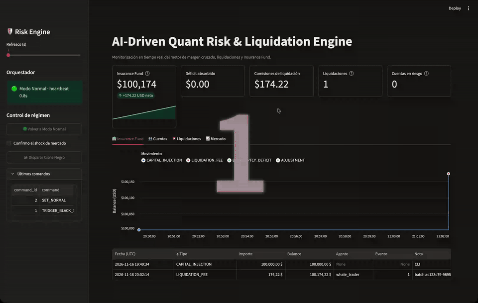
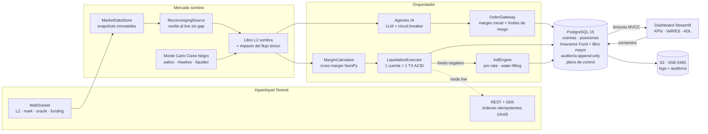
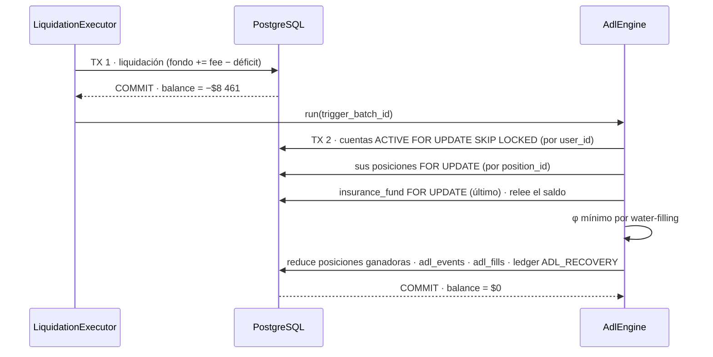
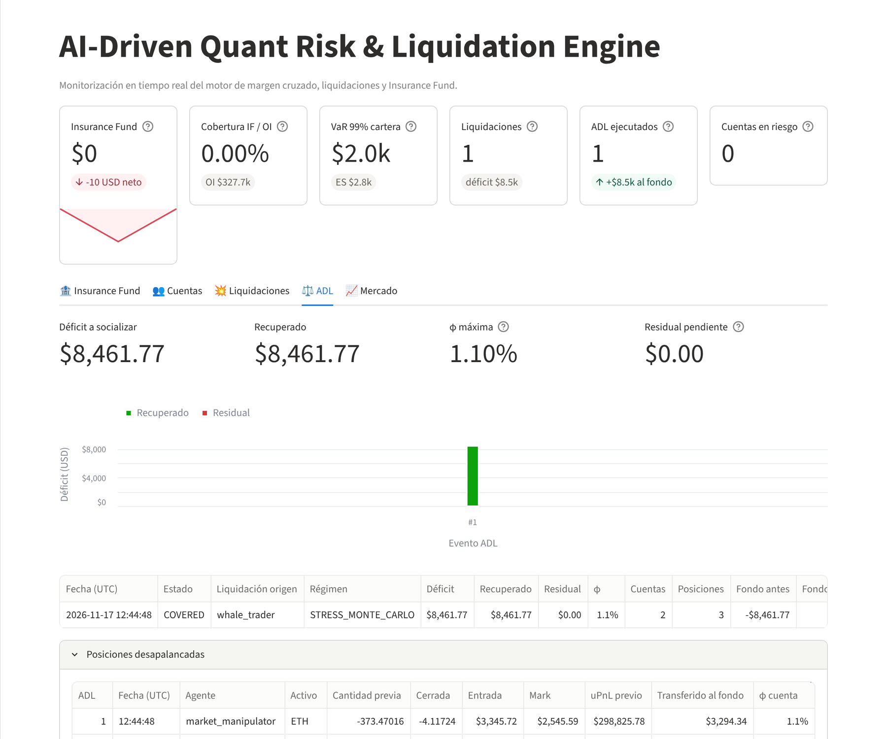

# AI-Driven Quant Risk & Liquidation Engine

**Motor de riesgo para derivados perpetuos cripto (Hyperliquid) con margen cruzado vectorizado, liquidaciones atómicas sobre PostgreSQL, Insurance Fund, Auto-Deleveraging y un mercado sombra que agentes de IA estresan con escenarios de Cisne Negro.**




<sub>Vídeo completo: [`RESULTADOS/demo_dashboard.mp4`](RESULTADOS/demo_dashboard.mp4) · [`.webm`](RESULTADOS/demo_dashboard.webm)</sub>

---

## En 30 segundos

| | |
|---|---|
| **Problema** | Un exchange de perpetuos debe decidir en milisegundos qué cuentas liquidar, cerrarlas sin dejar el sistema en un estado intermedio y absorber el *bad debt* cuando el precio atraviesa el de bancarrota. Si el Insurance Fund no basta, alguien tiene que pagar. |
| **Qué hace** | Calcula el margen cruzado de todas las cuentas en una pasada NumPy, liquida cada cuenta en **una única transacción ACID**, cobra comisiones o absorbe déficits en un **Insurance Fund con libro mayor inmutable** y, si el fondo queda en negativo, ejecuta un **ADL pro-rata** sobre las posiciones ganadoras. |
| **Cómo se prueba** | Tres agentes (LLM con salida estructurada o política determinista) operan contra un **mercado sombra** que replica el libro L2 de Hyperliquid. Un **Cisne Negro** Monte Carlo (difusión con saltos + Hawkes + colapso de liquidez) provoca la cascada. |
| **Qué se ve** | Dashboard Streamlit en tiempo real: Insurance Fund, cobertura IF/Open Interest, VaR/ES 99 %, health ratio por cuenta, liquidaciones con slippage y el historial de ADL. |
| **Calidad** | 135 tests (unitarios + integración contra PostgreSQL real + la app Streamlit con `AppTest`), migraciones con checksum, auditoría append-only exportada a S3, despliegue en EC2 sin puertos abiertos. |

---

## Arquitectura



| Módulo | Responsabilidad |
|---|---|
| [`exchange_connector/`](exchange_connector) | WebSocket con reconexión, heartbeat y watchdog; cliente REST con redondeo tick/lot conservador, reintentos con backoff + jitter y **reconciliación por `cloid`** antes de reintentar (una orden nunca se duplica por un timeout). |
| [`quant_models/`](quant_models) | GARCH/GJR/EGARCH (selección por BIC), VaR/ES histórico, filtrado, paramétrico Normal/t y Cornish-Fisher, **backtest de Kupiec**, Monte Carlo multi-activo con saltos sistémicos, intensidad Hawkes y factor de liquidez. |
| [`risk_engine/`](risk_engine) | Margen cruzado, liquidación atómica, **límites de riesgo**, **Auto-Deleveraging**. |
| [`ai_agents/`](ai_agents) | Agentes (LangChain + Pydantic), guardarraíles, mercado sombra, pasarela de órdenes, orquestador y plano de control. |
| [`database/`](database) | Esquema, protocolo de locks, migraciones idempotentes con checksum y advisory lock. |
| [`dashboard/`](dashboard) | Centro de control en tiempo real (solo lectura MVCC + cola de comandos). |
| [`deployment/`](deployment) | Imagen multi-target, compose de producción, EC2 + SSM + S3, export de auditoría. |

---

## Motor de margen cruzado

En *cross margin* todo el colateral de la cuenta respalda todas sus posiciones. Para cada cuenta `u` con posiciones `i` (cantidad con signo `q`, precio de entrada `e`, mark `m`, tasa de mantenimiento `mmr`):

```
uPnL_i     = q_i · (m_i − e_i)
Equity_u   = colateral_u + Σ uPnL_i
MM_u       = Σ |q_i| · m_i · mmr_i                    margen de mantenimiento
health_u   = Equity_u / MM_u                          liquidable  ⇔  health ≤ 1
P_liq,i    = (MM_otros − Eq_otros + q·e) / (q − |q|·mmr)    precio de liquidación (resto de la cuenta fijo)
P_bk,i     = e − Eq_otros / q                         precio de bancarrota: equity = 0
```

- **Vectorizado**: las métricas por posición se agregan por cuenta con `np.bincount`, sin bucles Python. **100 000 cuentas / 250 000 posiciones en ~115 ms** en un solo núcleo.
- **Fail-safe**: una cuenta con algún precio desconocido o rancio no se evalúa (`missing_prices`): nunca se liquida con un mark viejo.
- **Misma fórmula en todas partes**: el motor, la pasarela de órdenes, el ADL y el dashboard llaman a `compute_margins`.

## Liquidaciones atómicas

Una liquidación de cuenta es **una transacción**: o se aplica entera o no ocurre.

```
BEGIN  (READ COMMITTED · lock_timeout · statement_timeout)
  1. SELECT … FROM users_collateral  FOR UPDATE NOWAIT     ← otro worker la tiene: SKIPPED_LOCKED
  2. SELECT … FROM open_positions    FOR UPDATE ORDER BY position_id
  3. Re-evaluación bajo lock con precios frescos            ← el screening sin locks pudo quedar obsoleto
  4. Ejecución: L2 sombra (+ backstop si el libro no absorbe) o Hyperliquid reduce-only
  5. open_positions → LIQUIDATED
  6. INSERT liquidation_events                               ← append-only, batch UUID idempotente
  7. SELECT … FROM insurance_fund    FOR UPDATE               ← ÚLTIMO lock: la fila caliente se retiene ms
  8. fondo += fee − déficit  ·  INSERT insurance_fund_ledger
  9. users_collateral → colateral residual, LIQUIDATED
COMMIT
```

- **Orden de locks canónico** `users_collateral → open_positions → insurance_fund` en todo el sistema (pasarela, liquidador, ADL, reset): sin deadlocks; los residuales se reintentan con `retry_on_transient`.
- **Economía exacta en `Decimal`**: la comisión nunca crea déficit (`fee ≤ equity_after⁺`), el déficit y la comisión se reparten entre posiciones con suma exacta, y las identidades contables están en `CHECK` (`fund_delta = fee − deficit`).
- **Auditoría inmutable**: `liquidation_events`, `insurance_fund_ledger`, `adl_events` y `adl_fills` rechazan `UPDATE`/`DELETE` por trigger y se exportan incrementalmente a S3 (particionado Hive, consultable con Athena).

## Cisne Negro y Auto-Deleveraging

### El escenario

El orquestador alterna el mercado sombra entre precios en vivo de Hyperliquid (o un Monte Carlo «normal») y un **régimen de estrés**: la trayectoria del percentil 5 de 2 000 simulaciones de difusión con saltos, con saltos autoexcitados (Hawkes), correlaciones que tienden a 1 y un factor de liquidez que vacía el libro. El agente generador de estrés inyecta flujo vendedor tóxico contra el libro sombra. La ballena 20x cae; el liquidador ejecuta contra un libro sin profundidad y el backstop asume el resto con descuento: aparece el déficit.

Al terminar el estrés con `--live`, el precio sombra **reconverge** al real con semivida configurable en lugar de saltar de golpe (ver el postmortem).

### ADL: quién paga cuando el fondo no llega



Cada cuenta con beneficio no realizado cierra **la misma fracción φ** de sus posiciones ganadoras **al precio de entrada**: el beneficio de la parte cerrada pasa al fondo y el principal nunca se toca.

```
Σ_a min(φ, φmax_a) · U_a = S          S = déficit, U_a = beneficio no realizado de la cuenta a
φmax_a = (E_a − h·MM_a) / (U_a − h·MMw_a)     tope para que una cuenta cubierta conserve health ≥ h (1.10)
```

- **Justo**: misma φ para todos, independiente del orden de procesamiento.
- **Sin cascadas**: el tope `φmax` impide que el ADL deje liquidable a una cuenta con piernas perdedoras.
- **Exacto y acotado**: `Σ min(φ, φmax)·U` es lineal a trozos, se resuelve ordenando los topes (sin bisección); lo recuperado nunca supera el beneficio total.
- **Concurrencia**: `SKIP LOCKED` en vez de esperar a cuentas que están operando; si queda residual (`PARTIAL`) se reintenta en ciclos posteriores. Sin contrapartes (`NO_COUNTERPARTIES`) también queda auditado.



<sub>Cisne Negro con un fondo de $10: la liquidación de `whale_trader` deja un déficit de $8 461.77 que el ADL socializa entre 3 posiciones de 2 cuentas con φ = 1.1 %.</sub>

---

## Límites de riesgo y calibración

Dos capas, porque un LLM puede ignorar su prompt pero no la base de datos:

| Capa | Dónde | Qué aplica |
|---|---|---|
| Cliente | Guardarraíles del agente (`TradingAgent`) | Recorta sus propias decisiones a los límites de su perfil. Primera línea, no un control. |
| **Servidor** | `OrderGateway`, bajo el lock de la cuenta y en la misma transacción que la orden | `max_leverage` (bruto / equity) y `max_gross_notional_usd` de `users_collateral`. Las órdenes que reducen exposición nunca se bloquean. |

| Agente | Colateral | Apalancamiento máx. | Nocional bruto máx. |
|---|---:|---:|---:|
| `whale_trader` | $10k | 20x | $250k |
| `arbitrageur` | $100k | 3x | $400k |
| `market_manipulator` (generador de estrés) | $5M | 3x (objetivo 2x) | $10M |

Recalibración sin tocar código: `--max-leverage AGENTE=X`, `--max-notional AGENTE=USD` (repetibles). Al arrancar, un **chequeo pre-flight** compara el Insurance Fund con el peor *bad debt* de todas las cuentas al máximo de sus límites ante un salto adverso del 30 % (`--stress-jump`) y avisa si la cobertura es < 1×. El dashboard publica además la **cobertura IF / Open Interest** y el **VaR/ES 99 %** (Student-t, covarianza EWMA) de la cartera agregada y de cada cuenta.

### Postmortem: −$334k en una liquidación

| | |
|---|---|
| **Impacto** | Una sola liquidación del corto de `market_manipulator` (~$17M de nocional, ~15.5x efectivo) generó un déficit de **$334k**: el Insurance Fund de $100k quedó en **−$234k** y el sistema solo mostró una alerta. |
| **Causa raíz 1** | Al terminar el Cisne Negro con `--live`, el precio sombra saltaba en **un tick** del nivel crasheado al real (+20-30 %), atravesando el precio de bancarrota del corto. |
| **Causa raíz 2** | El único freno de exposición era el guardarraíl del propio agente: 5x sobre $5M sin tope absoluto y piramidando sobre beneficio no realizado. La cobertura de estrés era **0.04×**. |
| **Causa raíz 3** | Fondo en negativo = alerta pasiva; el déficit no se socializaba. |
| **Correcciones** | `ReconvergingSource` (sin gaps) · límites server-side + recalibración (cobertura 0.04× → 2.0×) · chequeo pre-flight · **ADL** real y auditado · las ráfagas de estrés se dimensionan con el *headroom* de la cuenta y se abortan al primer rechazo. |
| **Regresión** | `test_orchestrator_returns_to_live_without_gap`, `test_stress_coverage_flags_the_incident_calibration`, `test_liquidation_that_depletes_the_fund_triggers_adl_in_the_same_cycle`, `test_orchestrator_black_swan_with_thin_fund_runs_adl`. |

---

## Arranque rápido

### Opción A · Desarrollo local (PostgreSQL en Docker)

```bash
cp .env.example .env                                   # define POSTGRES_PASSWORD
docker compose up -d                                   # PostgreSQL 15 con esquema y migraciones
python -m venv .venv && source .venv/bin/activate
pip install -r requirements.txt -r requirements-dashboard.txt
python -m database.migrate                             # idempotente

# Terminal 1 · orquestador (sin OPENAI_API_KEY usa la política determinista)
python -m ai_agents.orchestrator --insurance-fund 100000 --black-swan-at 60

# Terminal 2 · dashboard → http://localhost:8501
streamlit run dashboard/app.py
```

Con `OPENAI_API_KEY` los agentes deciden con un LLM (salida estructurada Pydantic); si el proveedor falla tres veces seguidas, un circuit breaker los pasa a reglas durante 60 s. `--live` usa precios en vivo de Hyperliquid Testnet; `--crash-steps 1` reproduce un gap instantáneo.

### Opción B · Stack completo en contenedores

```bash
cd deployment
cp .env.production.example .env.production             # rellena los secretos (el entrypoint rechaza "change_me")
docker compose -f docker-compose.prod.yml --env-file .env.production up -d --build
# postgres → migrate (one-shot) → orchestrator + dashboard (127.0.0.1:8501) + log-shipper → S3
```

Producción en AWS (EC2 sin puertos de entrada, acceso por SSM, secretos en Parameter Store, S3 con KMS e IAM de mínimo privilegio): [`deployment/README.md`](deployment/README.md).

### Tests

```bash
pip install -r requirements-dev.txt
TEST_POSTGRES_HOST=127.0.0.1 TEST_POSTGRES_PASSWORD=… pytest      # 135 tests; sin PostgreSQL, los de integración se omiten
```

Cubren la matemática (margen, VaR/ES, GARCH, Monte Carlo, ADL), la concurrencia real contra PostgreSQL (locks, `SKIP LOCKED`, exactly-once de la cola de comandos, triggers append-only), la simulación de extremo a extremo y la app Streamlit.

---

## Resultados

| | |
|---|---|
|  |  |
| **Insurance Fund**: libro mayor inmutable, cada movimiento enlazado a su liquidación. | **Cuentas**: health ratio en tiempo real con la misma fórmula que el motor. |
|  |  |
| **Liquidaciones**: déficit por régimen y distribución del slippage. | **Mercado**: mark, oracle, basis y liquidez del libro sombra. |
|  |  |
| **Antes**: el incidente; fondo en −$234k y solo una alerta. | **Después**: el déficit se socializa con ADL y el fondo vuelve a $0. |

---

## Seguridad

- Ningún secreto en el repositorio ni en su historial: `.env`, `Claves.txt`, `*.pem`, `*.key` y `credentials*.json` están en `.gitignore`; las imágenes Docker excluyen además capturas y vídeos (`.dockerignore`).
- El entrypoint rechaza secretos de plantilla (`change_me`, `<SSM:…>`) y exige contraseña de operador para el dashboard en producción (comparación en tiempo constante).
- Mainnet bloqueado por defecto; la clave privada nunca aparece en `repr` ni en logs; el generador de estrés tiene prohibido por código cualquier enrutamiento externo.
- PostgreSQL solo en loopback; dashboard detrás de un port-forward de SSM.

<sub>Proyecto personal de Carlos Martín López. Simulación con fines de investigación en riesgo: el agente «manipulador» es un generador de estrés sintético contra un libro sombra, nunca contra un mercado real.</sub>
